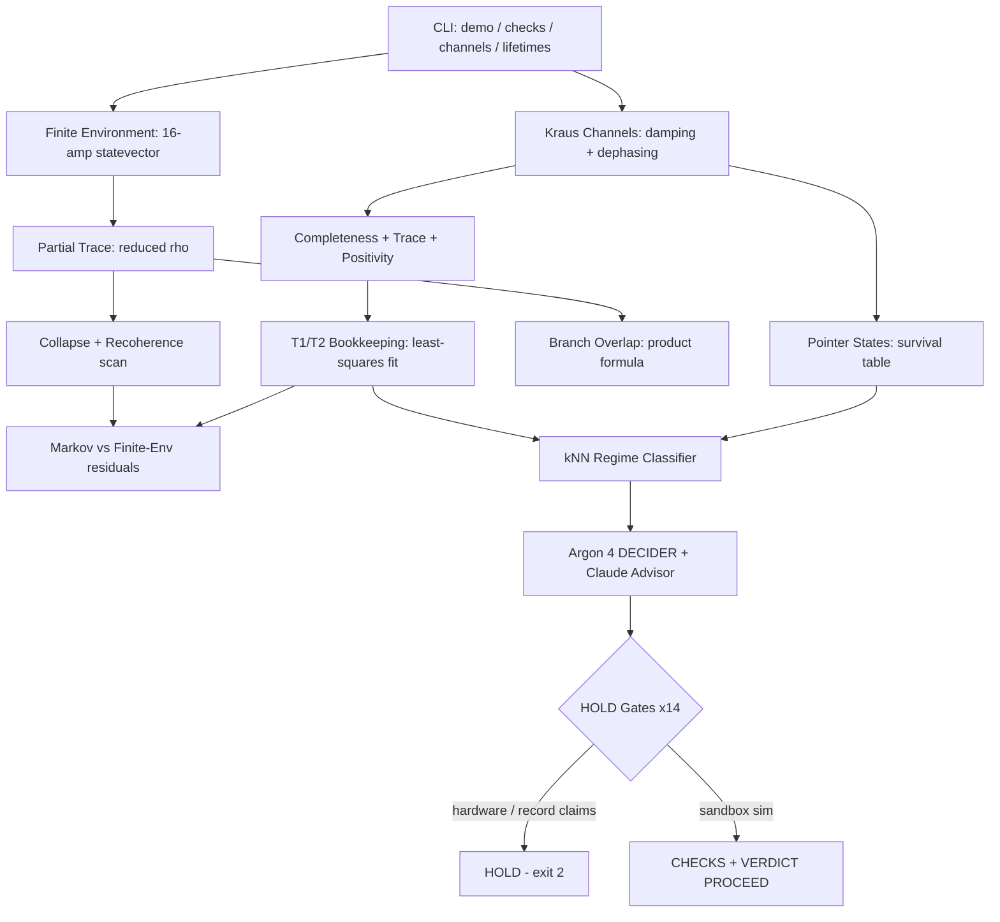
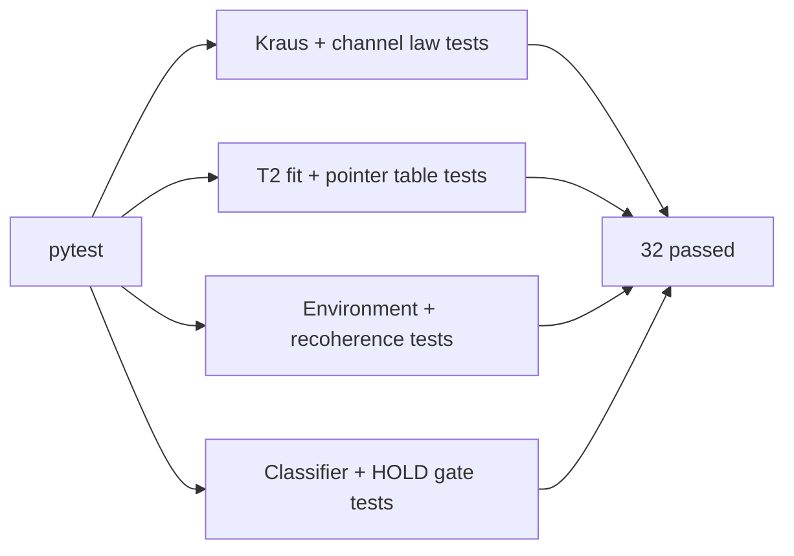
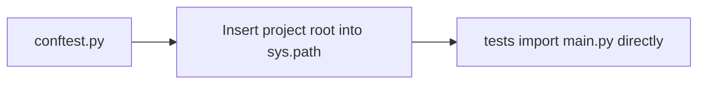
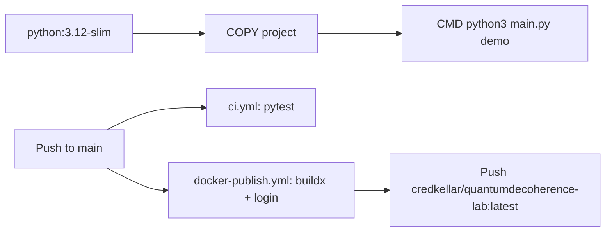

# QuantumDecoherence-Lab 🌀⚛️

**Decoherence Lab — Kraus Channels, T1/T2 Bookkeeping, Pointer States & Finite-Environment Recoherence** — by Darion Kellar

QuantumDecoherence-Lab is an **educational decoherence lab** in ONE pure-Python file. It computes decoherence **two honest ways**:

- **As channels** — amplitude damping and pure dephasing as explicit Kraus operators on a qubit density matrix, with the textbook bookkeeping `1/T2 = 1/(2·T1) + 1/T_phi` **fitted from the composed channel's decay curve and verified**, not quoted.
- **As a mechanism** — one qubit coupled to a **finite environment of three labelled spins**, evolved exactly as a 16-amplitude statevector. The coherence falls because the environment branches separate (their overlap is computed), and because three spins are not a bath, it partially **comes back**: recoherence to **0.917439** at t = 25.90, printed and fenced off as the finite-size artefact it is.

Honest scope, stated up front: every lifetime is a **labelled teaching number** (T1 = 50 µs, T_phi = 80 µs) — no qubit sat in a fridge, no device was measured, and nothing here is a specification, a benchmark, or a record. Every hardware / record / vendor / product claim sits behind a permanent HOLD gate (14 total). 🔒

[](https://github.com/kimanicollier44-cmyk/QuantumDecoherence-Lab/actions/workflows/ci.yml)
[](https://github.com/kimanicollier44-cmyk/QuantumDecoherence-Lab/actions/workflows/docker-publish.yml)

> ℹ️ These are the **live** workflow badges for this repo. They activate as soon as the `ci.yml` and `docker-publish.yml` files from the paste pack are pasted into `.github/workflows/` — until then they have nothing to report yet.

## 🧰 Tech Stack Badges & Full Architecture Tech Stack

### 💻 Core Programming Languages & Core Systems


- 🐍 Python 3.12, pure standard library (`cmath`, `math`, `hashlib`, `json`, `sys`) — zero dependencies, zero network, deterministic (double-run byte-identical)
- 🌀 Channel core: 2×2 complex density matrices and Kraus operators built by hand — amplitude damping `K0 = diag(1, √(1−γ))`, `K1 = √(γ)·|0⟩⟨1|`, phase-flip dephasing — completeness `Σ K†K = I` asserted to machine precision before any channel output is trusted
- 📉 Lifetime bookkeeping: the composed channel's coherence curve is fitted by least squares in log space, and the fitted T2 is graded against `1/T2 = 1/(2·T1) + 1/T_phi` — agreement is a check, not an assumption
- 🔬 Mechanism core: an exact 16-amplitude statevector for qubit + 3 environment spins under controlled-phase couplings, a partial trace done by index sums, and the branch-overlap product `∏ (1 + e^{−i·g_k·t})/2` asserted equal to the traced `ρ_01` at every sampled time
- 🧠 TinyML kNN regime classifier (from scratch, stdlib): coherent / dephasing-dominated / relaxation-dominated / pointer-stable from (T1, T_phi, elapsed time), labels from the lab's own regime policy
- 🪑 Council seats: Gemini Argon 4 DECIDER (names-only, tighten-only) + Muse advisor (never overrides HOLD) + Google Flow plan-only (rendered = False, live = 0)

### ⛓️ Web3 & Infrastructure

- 🚫 **Not applicable — honestly.** No blockchain, no Web3, no tokens: the "infrastructure" in this lab is a density matrix, two Kraus channels, and a 3-spin toy universe inside one offline file. No fake badges here.

### ⚙️ Platform Support & Hardware Architecture


- 🖥️ Pure Python — runs anywhere Python 3.12+ runs (Linux, macOS, Windows), plus the `python:3.12-slim` Docker image
- 🔒 No hardware is controlled, ever: real qubits, cryostats, and control electronics are permanent HOLD gates (see the gate table below)

### ⚡ Low-Level Infrastructure & Performance

- 🚫 **No low-level code — honestly.** No C, no C++, no GPU, no compiled extensions: this is one interpreted Python file on purpose, so every matrix entry can be read, checked, and diffed. Performance here means honest algorithms — closed-form channel parameters, an exact partial trace, and a 4,001-point scan of the environment curve — all deterministic and byte-identical between runs.

### 🛠️ DevOps & Build Tools


- 🐳 Docker (`python:3.12-slim`), GitHub Actions CI + Docker Publish (delivered in the paste pack)
- 🎯 Target image: `credkellar/quantumdecoherence-lab:latest`
- 🧪 Tests: `pytest` (32 tests) + the built-in CHECKS suite (47 checks) in `main.py`

### ☁️ Cloud Providers

- 🚫 **None — honestly.** No cloud provider is used or needed: the lab runs fully offline on your own machine or in a local Docker container. Docker Hub appears only as the registry the publish workflow pushes the image to.

## What this does?

1. 🧮 **Kraus channels, completeness first** — both channels are built as explicit operator pairs and `Σ K†K = I` is verified before anything is trusted: completeness error **0.00e+00** for amplitude damping at γ = 0.632121 and **1.11e-16** for dephasing at p = 0.316060. Trace preservation, hermiticity, and positivity of every output state are checked, not assumed.
2. ⬇️ **Amplitude damping — coherence dies at half the population rate** — with the labelled γ(t) = 1 − e^(−t/T1), the excited population falls by (1 − γ) while the coherence falls by √(1 − γ) — the square root is computed from the matrices, not quoted. At t = T1 = 50 µs: coherence ×**0.606531** (= e^−1/2) against population ×**0.367879** (= e^−1). The ground state is an exact fixed point; full damping lands exactly on |0⟩.
3. 🌫️ **Pure dephasing — the silent killer** — in phase-flip form, dephasing multiplies coherence by e^(−t/T_phi) and **never touches a population** (verified exactly at t = 11, 37.5, 80, 400 µs on a 0.7/0.3 mixture). At t = T_phi = 80 µs the coherence factor is ×**0.367879** with both populations bit-for-bit where they started.
4. 📉 **T1/T2 bookkeeping — fitted, not quoted** — labelled T1 = 50 µs and T_phi = 80 µs predict T2 = **44.444444 µs** via 1/T2 = 1/(2·T1) + 1/T_phi. The lab runs the composed channel, least-squares-fits log(coherence) vs t, and recovers T2 = **44.444444 µs** — relative error **0.0**. At t = T2 the composed coherence is 0.183940 = 0.5/e, as it must be.
5. 🎯 **Pointer states — the survival table** — dephasing at t = T_phi, computed per input state: |0⟩ and |1⟩ come out **untouched** (they are fixed points — there is no coherence to kill), |+⟩ and |+i⟩ lose exactly the e^−1 share of coherence (0.500000 → 0.183940), and the partial mixture keeps its 0.7/0.3 populations while its coherence falls 0.200000 → 0.073576. That asymmetry is what makes Z the pointer basis for this environment.
6. 🔬 **The mechanism — decoherence from entanglement** — the qubit (|+⟩) meets three environment spins (each |+⟩) through controlled-phase couplings g = (1.0, 1.7, 2.9). The joint 16-amplitude statevector is evolved exactly, the spins are traced out by index sums, and the reduced coherence equals **0.5 · ∏ (1 + e^(−i·g_k·t))/2** — the overlap of the two environment branches — to <1e-12 at every sampled time. Populations stay pinned at 0.5/0.5 throughout: this is pure dephasing with a visible cause.
7. 📉📈 **Collapse and recoherence — sized, not hidden** — the coherence factor crashes to **1.141e-06 at t = 9.24** (purity hits its 0.5 floor: the qubit is maximally entangled with the spins) — and then, because three spins are not a bath, it **returns to 0.917439 at t = 25.90**. The lab prints both numbers side by side with the fence: a macroscopic environment does not come back.
8. ⚖️ **Markovian vs finite environment — where the exponential story ends** — the same exponential yardstick is applied to both worlds. The Kraus channel deviates from its own exponential by at most **4.44e-16**. An exponential fitted to the environment's initial collapse (T_fit = 0.612532) predicts **4.33e-19** at the recoherence peak; the actual factor is **0.917439** — max residual **0.917439**, RMS residual **0.344814**. That gap is the exact place the Markov approximation stops being true.
9. 🏷️ **Regime classifier** — a from-scratch kNN over a policy-labelled (T1, T_phi, t) grid: a fresh long-lived qubit reads **coherent**, a T_phi-starved device **dephasing-dominated**, a T1-starved device **relaxation-dominated**, a long-dephased but population-intact state **pointer-stable**, and an aged 25/25 state **dephasing-dominated** — and the classifier is checked against the policy on every scenario and every grid point (1-NN sweep).
10. 🔒 **Seats + gates + checks** — Gemini Argon 4 DECIDER (sha256 trace, tighten-only), Muse advisor (never overrides HOLD), Google Flow plan-only, 14 permanent HOLD gates, and a built-in CHECKS suite (**47 checks**) that recomputes every headline number above.

## 🗺️ How it works — diagram per script

### `main.py` — the whole lab



### `tests/test_main.py` — verification



### `conftest.py` — test path setup



### `Dockerfile` + CI flow — container & publish



## Why is this cool?

1. 📉 The T2 relation is **measured in the lab, not recited**: fit the composed channel's decay and the textbook line 1/T2 = 1/(2·T1) + 1/T_phi comes back with relative error **0.0**.
2. ⬇️ The square-root law falls out of matrices: amplitude damping takes population by (1 − γ) and coherence by √(1 − γ) — run it at t = T1 and watch ×0.367879 stand next to ×0.606531.
3. 🌫️ Dephasing is shown as the thief that leaves no fingerprints: populations bit-for-bit identical, coherence down by e^−1 — the exact reason phase errors dominate real devices.
4. 🎯 The pointer basis stops being a definition and becomes a table: five input states, one channel, and only the superpositions bleed.
5. 🔬 Decoherence gets a **visible mechanism**: the coherence of the reduced state equals the environment branch overlap to <1e-12 — "the environment learned which state" as an equation, not a metaphor.
6. 📈 The recoherence is printed at full size — **0.917439** — next to its fence, instead of being quietly averaged away. The lab trusts you with the artefact and tells you exactly why it's an artefact.
7. ⚖️ The Markov approximation is given a **measured breaking point**: max residual 0.917439, at a named time (t = 25.90), against 4.44e-16 for the true channel.
8. 🧮 Everything is exact small-matrix arithmetic: 2×2 Kraus maps and a 16-amplitude statevector — the entire physics content fits in your head and in one file.
9. 🏷️ The classifier's labels come from the lab's own regime policy and are audited against it on all 150 grid points — interpolation you can cross-examine.
10. 🎯 Deterministic end to end: run it twice, get byte-identical output — decoherence you can diff.

## What problems this solves?

1. ❌ **Problem:** "T2" gets quoted as if it were a third independent lifetime. ✅ **Solution:** The lab derives it — fit the composed channel and the 1/(2·T1) + 1/T_phi split is recovered to relative error 0.0.
2. ❌ **Problem:** Decoherence is taught as a mysterious fog that "destroys quantumness". ✅ **Solution:** The mechanism is computed: branch overlap of a 3-spin environment, equal to the lost coherence to <1e-12.
3. ❌ **Problem:** Amplitude damping and dephasing are blurred into one "noise". ✅ **Solution:** Two explicit Kraus channels with different fingerprints — populations move under one, never under the other; coherence obeys a square-root law under one, a plain exponential under the other.
4. ❌ **Problem:** Pointer states are asserted, not demonstrated. ✅ **Solution:** A five-state survival table under the actual channel: basis states untouched, superpositions down by exactly e^−1, mixture in between.
5. ❌ **Problem:** Textbook exponentials are presented as the whole story of open systems. ✅ **Solution:** The finite-environment curve is scanned over 4,001 points and the exponential's failure is sized: max residual 0.917439, RMS 0.344814.
6. ❌ **Problem:** Recoherence in toy models gets oversold as "beating decoherence". ✅ **Solution:** The peak is printed at full size **and** fenced — `recoherence_recovery_claim` is a permanent HOLD gate, and the README says why on the same line.
7. ❌ **Problem:** Labelled teaching numbers quietly harden into "device specs" as they get copied. ✅ **Solution:** T1/T_phi are called LABELLED in the code, the demo, and this README, and `device_specification_claim` + `coherence_record_claim` are HOLD gates.
8. ❌ **Problem:** Channel math is usually hidden inside a library call. ✅ **Solution:** The Kraus operators are two-line matrices in the source; completeness Σ K†K = I is a printed, checked number.
9. ❌ **Problem:** "The environment is Markovian" is an assumption students never see fail. ✅ **Solution:** The same fit procedure is applied to both worlds and only one survives it — the comparison itself is the lesson.
10. ❌ **Problem:** Simulation tools quietly imply a hardware result is next. ✅ **Solution:** 14 named HOLD gates return exit code 2 for every hardware, record, benchmark, or product claim, forever.

## How to install this?

1. 📋 Clone or download this project folder.
2. 🐍 Make sure Python 3.12+ is installed: `python3 --version`
3. ▶️ Run the full demo + checks (no arguments needed):

```bash
python3 main.py
```

4. 🧪 Run the test suite:

```bash
pip install pytest
python3 -m pytest -q
```

5. 🎛️ Try the other commands:

```bash
python3 main.py checks      # 47 built-in checks
python3 main.py channels    # Kraus channels + coherence decay report (JSON)
python3 main.py lifetimes   # T1/T_phi -> fitted T2 vs the relation (JSON)
python3 main.py pointer     # pointer-state survival table (JSON)
python3 main.py environment # 3-spin mechanism: collapse + recoherence (JSON)
python3 main.py markov      # exponential residuals, both worlds (JSON)
python3 main.py classify    # kNN regime classifier report
python3 main.py brains      # Argon 4 + Muse + Flow seats
python3 main.py holds       # list all 14 HOLD gates
python3 main.py hold-demo   # exits 2 - gated actions stay HOLD
```

6. 🐳 Or run it in Docker:

```bash
docker build -t credkellar/quantumdecoherence-lab:latest .
docker run --rm credkellar/quantumdecoherence-lab:latest
```

## Requirements

- 🐍 Python 3.12 or newer
- 📦 Dependencies: **none** (standard library only)
- 🌐 Network: **none** — fully offline
- 🧪 For tests only: `pytest`
- 🐳 Optional: Docker

## FULL project structure tree

```text
quantumdecoherence-lab/
├── main.py                  # the whole lab: Kraus channels, T1/T2 fit, pointer states, 3-spin environment, Markov comparison, classifier, seats, HOLD gates
├── conftest.py              # puts the project root on sys.path for tests
├── tests/
│   └── test_main.py         # 32 pytest tests: channels, T2 fit, pointer table, environment, Markov residuals, gates, determinism
├── assets/
│   └── cover.png            # README cover image (2736 x 912)
├── Dockerfile               # python:3.12-slim, runs the demo
├── .gitignore               # __pycache__/, .pytest_cache/, *.pyc
└── README.md                # this file
```

> 📦 Delivered separately as paste packs (not in this tree): `.github/workflows/ci.yml` + `docker-publish.yml`, and the Docker Hub pack (100-char description, 350-char About, overview, categories).

## 🔒 HOLD gates — all 14, permanent

| # | Gate | What stays held |
|---|------|-----------------|
| 1 | `real_hardware_control` | No control of real qubits, cryostats, or lab hardware from a teaching file |
| 2 | `coherence_record_claim` | No record-T1/T2 or coherence-breakthrough claim; every lifetime here is a labelled teaching number |
| 3 | `device_specification_claim` | T1, T_phi, and T2 in this lab are not specifications of any real device |
| 4 | `vendor_benchmark_claim` | No vendor comparison, benchmark, or leaderboard claim |
| 5 | `fault_tolerance_claim` | No claim that any real processor sits above or below a fault-tolerance threshold |
| 6 | `quantum_memory_product_claim` | Pointer-state survival math is not a quantum memory product |
| 7 | `error_correction_guarantee_claim` | No guarantee that error correction fixes real-world decoherence |
| 8 | `recoherence_recovery_claim` | Finite-environment recoherence is an artefact of a 3-spin universe; never a way to beat decoherence in a real device |
| 9 | `live_experiment_direction` | No directing live experiments from this lab |
| 10 | `cryogenics_operation_claim` | No cryostat or dilution-refrigerator operation guidance |
| 11 | `fabrication_instruction_claim` | No qubit fabrication instructions |
| 12 | `certified_metrology_claim` | No certified measurement or metrology claim from toy channel math |
| 13 | `investment_claim` | No investment claims; a lab model is not a prospectus |
| 14 | `medical_device_claim` | No medical, imaging, or clinical sensing claim from toy channel math |

🧑‍⚖️ **Council seats:** Gemini Argon 4 Extended Thinking — DECIDER (names-only, tighten-only, MAP → MODEL → STRESS → DECIDE, sha256 trace, `can_override_hold = False`) · Muse — advisor (`can_override_hold = False`) · Google Flow — plan-only (`rendered = False`, `live = 0`).

✅ **Verification:** pytest **32 passed** (project + clean copy) · built-in CHECKS **47/47** · double-run output **byte-identical** · `hold-demo` exits **2** · `main.py` **848 lines**, pure stdlib, zero network.

## 🧒 5th-grade English section

Imagine you spin a coin on a table and it spins in a perfect, wobbly dance. That dance is like a qubit's secret twirl — scientists call the twirl **coherence**. 🌀

- Two things can ruin the dance. **Damping** is like the coin slowly tipping over and lying flat — it loses energy and ends up face-up on the table. **Dephasing** is sneakier: the coin keeps spinning, but you forget exactly *how* it was twirling. The twirl information is gone even though the coin still stands. 🪙
- This lab does the math for both kinds of ruining, with two stopwatches: T1 for the tipping-over kind and T_phi for the forgetting kind. It even checks its own stopwatch math — a third stopwatch, T2, that it **measures from the dance instead of just believing the formula**. ⏱️
- Some poses survive the forgetting completely: a coin lying flat or standing still doesn't care. Those are called **pointer states** — the poses the room "likes". Poses in the middle of the dance are the ones that fade. 🎯
- Then the lab shows *why* the forgetting happens: the twirl information leaks into the room. In the lab's tiny pretend room there are only **three tiny spins** to leak into — so, after a while, the information leaks **back**, and the dance partly returns! In a real room there are trillions and trillions of places for the information to hide, so it never comes back. The lab prints the pretend comeback at full size and tells you plainly: that's a small-room trick, not real magic. 🔬
- This project is a **pretend lab on a computer**. It does not touch a real quantum computer. It helps you learn why keeping a qubit's twirl alive is one of the hardest jobs in science. 💻

---

MIT © 2026 Darion Kellar · QuantumDecoherence-Lab — educational simulation only 🌀
